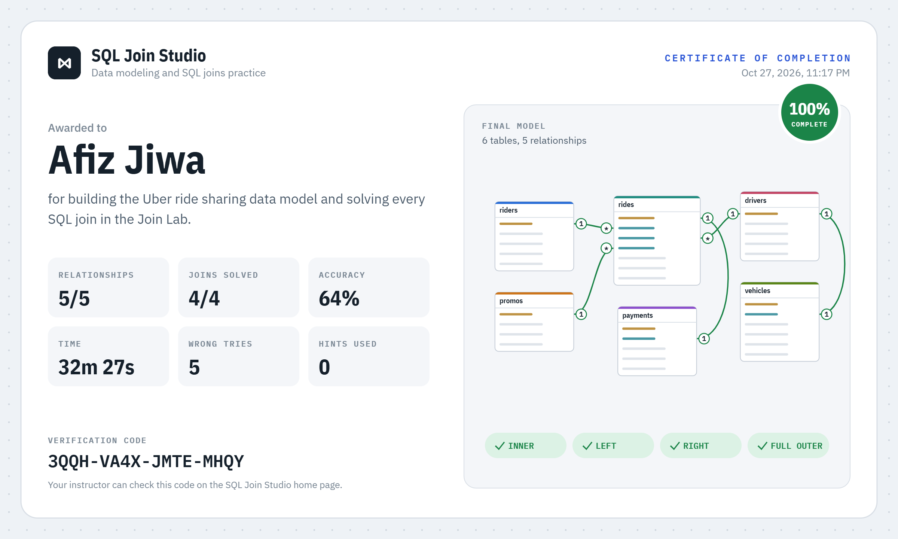
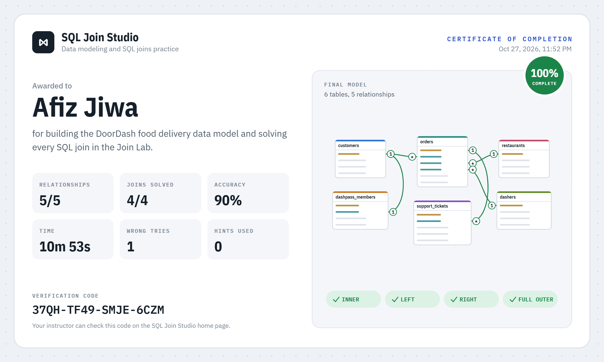
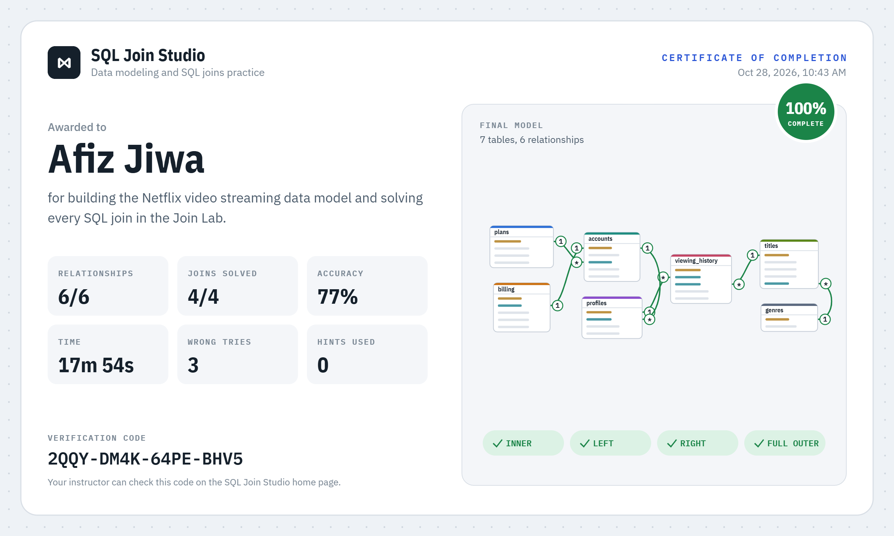
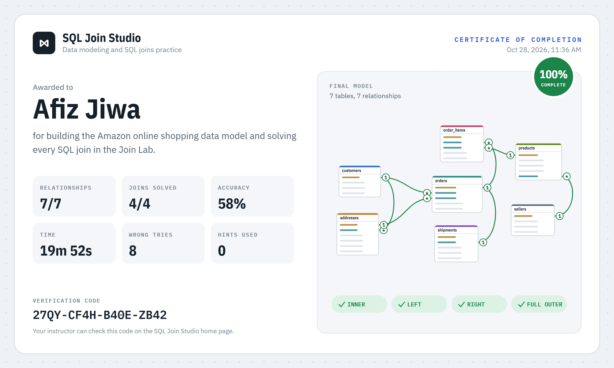

# SQL Join Studio Certificates

Practice from the SDI SQL Server module (Session 20: Joins), completed October 27 to 28, 2026.

In each lab I built a relational data model by connecting the tables with the right one-to-many relationships, then solved all four join types against it: INNER, LEFT, RIGHT and FULL OUTER. I finished every lab at 100% without using hints. 

| Data model | Tables | Relationships |
|---|---|---|
| Uber ride sharing | 6 | 5 |
| DoorDash food delivery | 6 | 5 |
| Netflix video streaming | 7 | 6 |
| Amazon online shopping | 7 | 7 |

The Amazon model was the hardest because of `order_items`, a bridge table that links orders and products in a many-to-many relationship.

## Certificates

